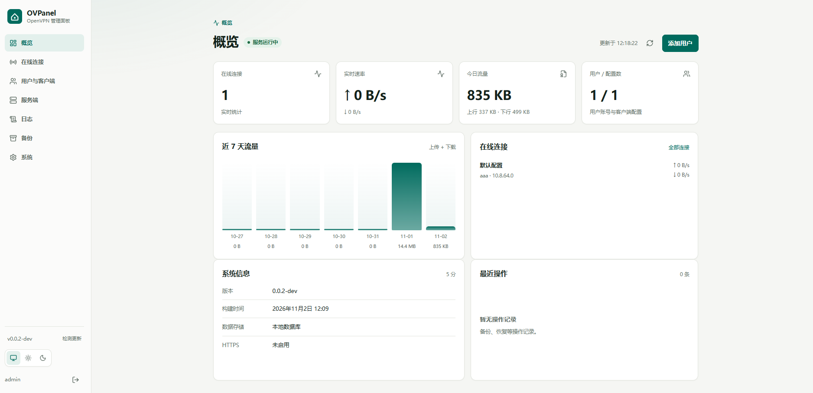
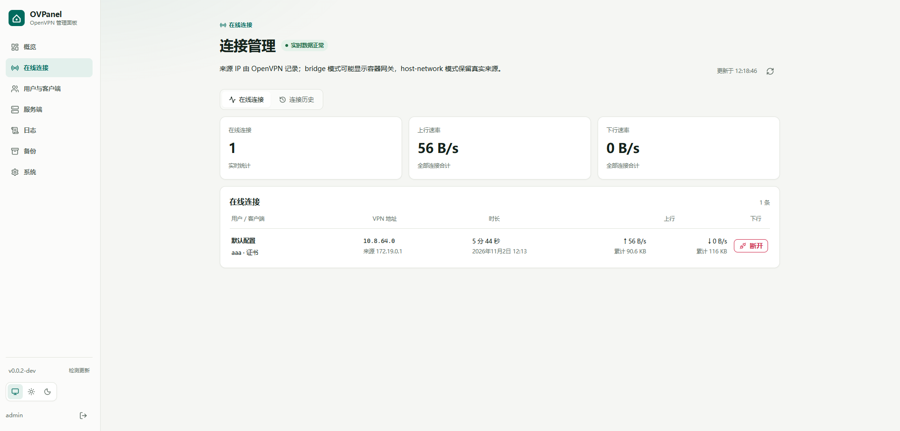
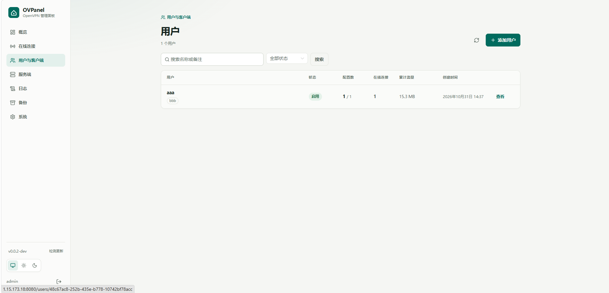
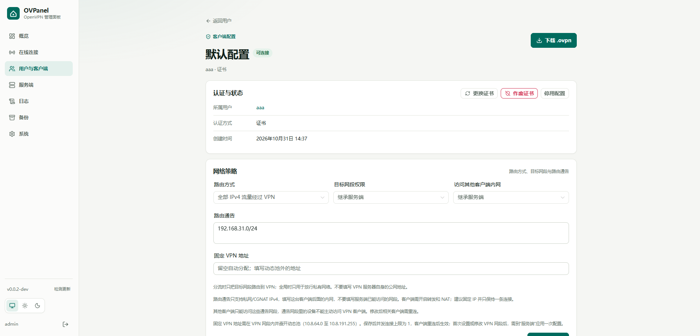
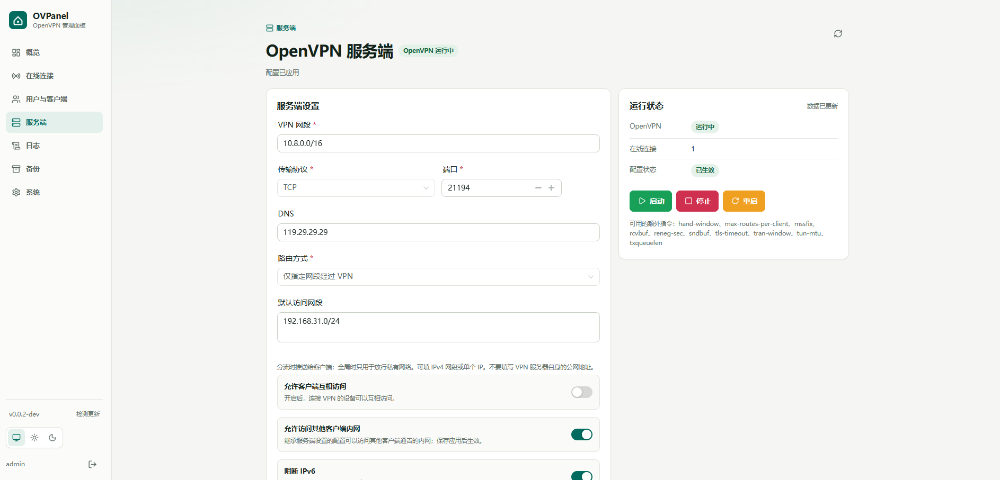

<div align="center">

# OVPanel

**OpenVPN 服务端管理面板**

用户与客户端管理 · 网络策略 · 流量统计 · 加密备份


**[界面预览](#界面预览)** · **[快速部署](#快速部署)** · **[使用指南](#开始使用)** · **[部署手册](deploy/README.md)** · **[Releases](https://github.com/dreamstation625/OVPanel/releases)**

</div>

---

## 功能特性

| 能力 | 功能 |
| --- | --- |
| **用户与客户端** | 多配置管理，证书 / 证书加密码 / 仅密码认证，导出 `.ovpn` |
| **访问控制** | 到期时间、并发上限、流量额度、每条连接独立上传 / 下载限速 |
| **网络策略** | 内网分流、IPv4 全局出口、网段权限、客户端互访、固定 IP、内网共享 |
| **服务端管理** | 网段、UDP / TCP、端口、DNS、加密与 TLS 参数、额外指令检查、启停与重启 |
| **连接与统计** | 在线连接、来源地址、实时速率、历史流量、操作记录、手动断开连接 |
| **备份与恢复** | 手动 / 每日自动加密备份、保留策略、下载与恢复前检查 |
| **界面与管理** | 浅色 / 深色 / 跟随系统，手机适配，HTTPS，正式版本更新提示 |

## 界面预览



<p align="center"><sub>在线连接 · 实时速率 · 流量趋势 · 服务状态</sub></p>

<details>
<summary><strong>展开更多界面</strong> · 连接管理 / 用户 / 客户端 / 服务端</summary>

| 连接管理 | 用户列表 |
| :---: | :---: |
| [](img/02.webp) | [](img/03-1.webp) |
| **客户端配置** | **服务端设置** |
| [](img/03-2.webp) | [](img/04.webp) |

点击截图可查看原图。

</details>

---

## 快速部署

> **推荐 host 网络**：OpenVPN 直接监听宿主数据端口，避免 Docker bridge 转发影响客户端来源地址的记录。面板仍使用 bridge，默认仅绑定 `127.0.0.1:8080`。

**宝塔 / 1Panel 部署：** 准备好下文的 Linux 宿主环境后，在面板中新建 Compose 编排，粘贴 [compose.host.yaml](compose.host.yaml)，将 [.env.host.example](.env.host.example) 保存为编排目录的 `.env`，或填入面板的编排环境变量配置。默认使用配套的 `dev` 镜像，数据目录为 `/opt/ovpanel/data`，无需克隆仓库。详见[面板部署说明](deploy/README.md#宝塔--1panel-部署)。

命令行使用独立 host 编排时，也可以把环境变量单独保存为 `.env.host`：

```bash
docker compose --env-file .env.host -f compose.host.yaml up -d
```

后续 `ps`、`logs`、`down` 等操作保留同样的 `--env-file .env.host -f compose.host.yaml`。不要与 `compose.yaml` / `compose.hostnet.yaml` 混用；`.env.host` 含主密钥或口令时不要提交到仓库。

以下步骤为克隆仓库后的命令行部署方式。

### 1. 准备环境

- Linux amd64 / arm64，使用 rootful Docker Engine。
- Docker Compose v2，需支持 host 覆盖文件中的 `!reset` 标签。
- 宿主具备 `/dev/net/tun`，可加载 `ifb`、`sch_htb`、`act_mirred` 内核模块。
- VPN 数据端口（默认 `1194/udp`）和本机管理端口 `9443/tcp` 未被占用。

Windows / macOS Docker Desktop 和 rootless Docker 不作为生产部署环境。

以下命令均在 Linux 宿主执行：

```bash
git clone https://github.com/dreamstation625/OVPanel.git
cd OVPanel
cp .env.example .env
./deploy/check-host.sh --data-dir ./data
```

处理检查中的 `[fail]` 项。host 模式需在宿主开启 IPv4 转发并持久化：

```bash
printf 'net.ipv4.ip_forward=1\n' | sudo tee /etc/sysctl.d/90-ovpanel.conf
sudo sysctl -p /etc/sysctl.d/90-ovpanel.conf
```

### 2. 选择镜像并启动

编辑 `.env`，设置两个镜像使用相同的发布标签。例如使用最新正式版：

```dotenv
OVPANEL_PANEL_IMAGE=dreamstation625/ovpanel:latest
OVPANEL_OPENVPN_IMAGE=dreamstation625/ovpanel-openvpn:latest
```

建议生产环境按 [Release](https://github.com/dreamstation625/OVPanel/releases) 固定具体版本。`dev` 为开发预发布标签；复制开发分支的 `.env.example` 后，请确认是否需要切换。

`OVPANEL_DOCKER_SUBNET` 控制面板容器所在的 `ovpanel` Docker bridge 子网，默认 `10.250.0.0/24`。它不能与 VPN 网段、目标网段、客户端共享内网或宿主局域网重叠；修改后需停止面板、删除旧 `ovpanel` 网络后重新启动，否则 Compose 会继续使用旧子网。

```bash
docker compose -f compose.yaml -f compose.hostnet.yaml pull
docker compose -f compose.yaml -f compose.hostnet.yaml up -d --no-build
docker compose -f compose.yaml -f compose.hostnet.yaml ps
```

host 模式下，OpenVPN 的 nftables 规则作用于宿主网络；入口脚本维护 VPN 地址池转发及 UFW 数据端口规则。云服务器还需在安全组放行 VPN 数据端口，`9443` 管理端口仅监听回环地址，不要对外开放。

后续启动、重建和升级均保留 `-f compose.yaml -f compose.hostnet.yaml`。此模式不使用 `deploy/compose.sh` 或 `deploy/ensure-forwarding.sh`，这两个脚本用于 bridge 部署。

### 3. 初始化管理员

读取一次性初始化口令：

```bash
docker compose -f compose.yaml -f compose.hostnet.yaml exec panel cat /data/bootstrap-token
```

也可以直接在宿主数据目录的 `panel/bootstrap-token` 读取，不需要进入容器。CLI 部署默认路径是 `./data/panel/bootstrap-token`，独立 host 编排默认是 `/opt/ovpanel/data/panel/bootstrap-token`。

在服务器本机打开 `http://127.0.0.1:8080`，输入口令并创建管理员。远程部署时可先在自己的电脑建立 SSH 隧道，再访问同一地址：

```bash
ssh -L 8080:127.0.0.1:8080 <SSH用户>@<服务器地址>
```

没有默认管理员密码。初始化成功后口令文件自动删除，初始化接口关闭。需要公网或局域网管理时，先按[部署手册的 HTTPS 说明](deploy/README.md#https)配置证书，再调整绑定地址。

<details>
<summary><strong>可选：使用 bridge 网络部署</strong></summary>

需要将 OpenVPN 网络与宿主隔离时，使用基础 Compose 文件和部署脚本：

```bash
./deploy/compose.sh pull
./deploy/compose.sh up -d --no-build
```

`compose.sh up -d` 会检查并补齐项目 bridge 网络的宿主转发和 NAT，需要 root 或免密 sudo。使用裸 `docker compose` 或 1Panel 部署时，见[宿主转发与 NAT](deploy/README.md#宿主转发与-nat)。

</details>

## 开始使用

1. 在「服务端」设置 VPN 网段、协议、端口、DNS 和路由策略，保存并应用。
2. 在「系统 → VPN 连接地址」填写客户端可访问的服务器 IP / 域名与端口。
3. 在「用户与客户端」添加用户和客户端配置，选择认证方式、权限及使用限制。
4. 下载 `.ovpn` 文件，导入 OpenVPN 客户端连接；在「在线连接」查看结果。
5. 在「备份」设置恢复密码和每日备份计划，将备份包下载到其他设备保存。

`.env` 中的 `OVPANEL_VPN_PORT` / `OVPANEL_VPN_PROTO` 与服务端配置的监听端口/协议一致。客户端连接地址可以使用 NAT 映射后的外部端口，端口不必与服务端监听端口相同，但协议仍需一致。修改监听端口或协议后重建 OpenVPN 容器，并检查宿主防火墙与云安全组。

固定 VPN 地址需在 VPN 网段内并避开动态池，设置后该配置并发上限为 1。动态池地址由 OpenVPN 持久化保留，同一配置重连时优先复用原地址，不会在 30 天内自动更换；仅密码登录使用登录名作为租约身份。配置到期时间默认不设置；新签发的客户端证书默认有效期 15 年，已有客户端证书不会自动延长，需要更换并重新下载配置。服务端证书可在“系统 → 证书”中续签，续签保留私钥，客户端不需要重新下载。旧 CA 的剩余有效期会限制新证书期限。客户端内网共享的路由与回程要求见[客户端内网共享](deploy/README.md#客户端内网共享)；调整加密参数后的客户端兼容要求见[OpenVPN 加密与连接](deploy/README.md#openvpn-加密与连接)。

## 常用配置

在根目录 `.env` 中修改，完整示例见 [`.env.example`](.env.example)。

<details>
<summary><strong>展开环境变量说明</strong></summary>

| 变量 | 默认值 / 示例 | 说明 |
| --- | --- | --- |
| `OVPANEL_PANEL_IMAGE` | `dreamstation625/ovpanel:<tag>` | 面板镜像 |
| `OVPANEL_OPENVPN_IMAGE` | `dreamstation625/ovpanel-openvpn:<tag>` | OpenVPN 镜像，与面板版本配套 |
| `OVPANEL_ADMIN_BIND` | `127.0.0.1` | 面板宿主绑定地址 |
| `OVPANEL_ADMIN_PORT` | `8080` | 面板宿主端口 |
| `OVPANEL_VPN_PORT` / `OVPANEL_VPN_PROTO` | `1194` / `udp` | VPN 数据端口和协议 |
| `OVPANEL_VPN_BIND` | `0.0.0.0` | 仅用于 bridge 模式的端口映射绑定 |
| `OVPANEL_DOCKER_SUBNET` | `10.250.0.0/24` | 面板所在 Docker bridge 子网，不能与 VPN/目标网段重叠 |
| `OVPANEL_DATA_ROOT` | `./data` | 宿主持久化目录 |
| `OVPANEL_CERT_DIR` | `./certs` | 宿主 HTTPS 证书目录 |
| `OVPANEL_TLS_CERT` / `OVPANEL_TLS_KEY` | 空 | 容器内证书 / 私钥路径，同时设置以启用 HTTPS |
| `OVPANEL_SESSION_TTL` | `12h` | 管理员会话时长，最大 7 天 |
| `OVPANEL_LOG_LEVEL` | `info` | `debug` / `info` / `warn` / `error` |

`OVPANEL_BOOTSTRAP_TOKEN` 可指定至少 16 字符的初始化口令，留空自动生成。`OVPANEL_MASTER_KEY` 可注入 32 字节主密钥（base64 / hex），留空生成 `master.key`。`OVPANEL_DEV_SELF_SIGNED` 仅用于本机调试。

</details>

## 数据与升级

运行数据保存在 `data/`，HTTPS 证书保存在 `certs/`，重建容器不会删除这些目录。

**请同时保护数据库、`master.key` 和客户端 `.ovpn` 文件。** 丢失主密钥将无法解密已有证书私钥及 tls-crypt 密钥。加密备份包含主密钥，恢复密码需单独保管；运行中请通过面板创建一致性备份。

面板可检查正式 Release 并展示更新说明，升级由管理员在宿主执行 Docker 命令。先创建并验证备份，再在 `.env` 中将两个镜像改为目标版本，按部署时相同的网络模式操作。host 模式示例：

```bash
docker compose -f compose.yaml -f compose.hostnet.yaml pull
docker compose -f compose.yaml -f compose.hostnet.yaml up -d --no-build --no-deps --force-recreate panel
docker compose -f compose.yaml -f compose.hostnet.yaml up -d --no-build --no-deps --force-recreate openvpn
docker compose -f compose.yaml -f compose.hostnet.yaml ps
```

重建 OpenVPN 会断开现有连接，请安排维护窗口。版本兼容、恢复与升级细节见[部署手册](deploy/README.md)。

## 构建触发

普通代码推送不会自动重建发布镜像。只有根目录的 `AutoBuild` 或 `VERSION` 发生变化时才运行镜像构建和 Release：

- 需要重建 `dev` 镜像时，更新 `AutoBuild` 中的 UTC 时间戳即可；时间戳内容本身不参与构建。
- 正式版仍以 `VERSION` 为准；只修改 `AutoBuild` 不会重复发布已存在的正式版本。
- 推送后可在 GitHub Actions 手动触发工作流，但仍受版本标签规则限制。

## 项目结构

```text
cmd/                   面板、VPN 运行代理与受限维护进程入口
internal/              API、认证、用户、证书、策略、统计与备份
web/                   Vue 3 + Naive UI 前端
deploy/                Dockerfile、部署检查、网络脚本与运行手册
img/                   README 界面截图
compose.yaml           双容器基础配置（bridge）
compose.hostnet.yaml   OpenVPN host 网络覆盖配置（推荐）
compose.host.yaml      宝塔 / 1Panel 可直接使用的独立 host 配置
.env.example           部署环境变量示例
.env.host.example      独立 host 部署环境变量示例
VERSION                版本号唯一来源
AutoBuild              镜像构建触发时间戳
```

`panel` 负责 Web、内嵌前端与 SQLite；`openvpn` 运行 OpenVPN 与代理，不挂载 Docker Socket。面板容器内的受限维护进程持有 Docker Socket，Web 进程不直接访问它。容器权限与数据目录说明见[容器边界](deploy/README.md#容器边界)。

---

<div align="center">

**本项目由 ChatGPT + Qoder 完成。**

[↑ 返回顶部](#ovpanel)

</div>

## 免责声明

请仅在合法授权的环境中使用本项目，并遵守适用的法律法规，不得用于违法或未经授权的活动。

本项目按“现状”提供，不对稳定性、安全性或特定用途的适用性作出保证。使用前请自行评估风险，妥善保护账号、密钥与备份。在适用法律允许的范围内，项目作者及贡献者不对使用或修改本项目造成的损失承担责任。
